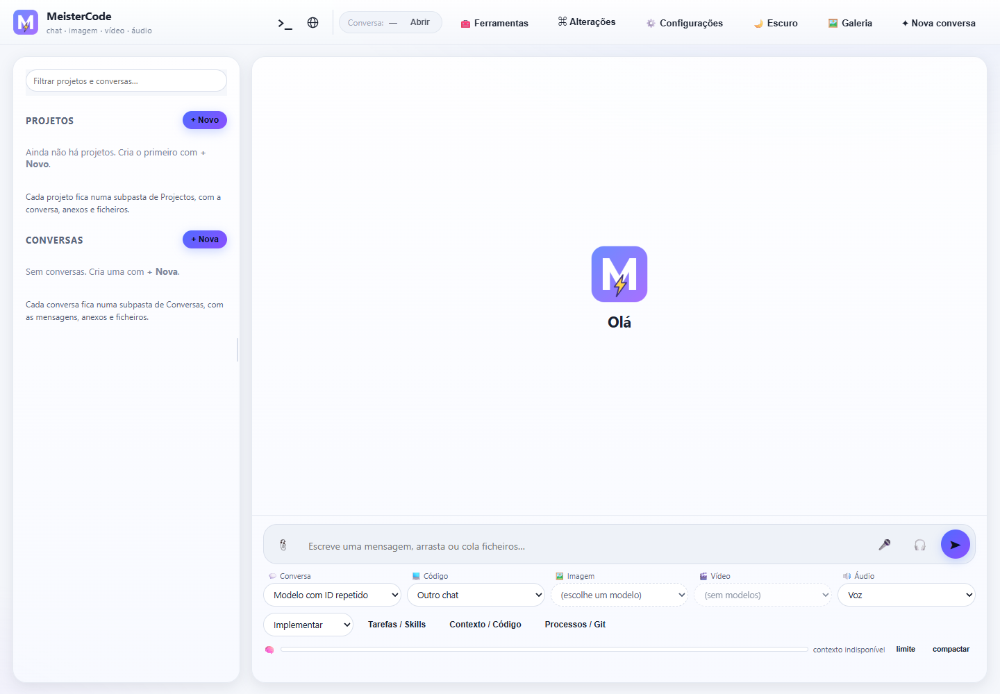

<p align="center"></p>

# MeisterCode

Aplicação de secretária para Windows que junta, numa só janela, **conversa com modelos de IA**, **geração de imagem, vídeo e áudio** e um **agente de programação** que lê, escreve e corre código nas tuas pastas. Funciona com provedores online (OpenRouter e outros) ou com modelos teus, a correr em casa.

A interface e a documentação estão em português de Portugal.



> **Estado do projeto:** é um projeto pessoal em desenvolvimento ativo, feito para uso próprio e de amigos. Funciona, tem testes automáticos, mas muda depressa e não tem garantias. Usa-o por tua conta e risco.

## O que faz

- **Um modelo para cada coisa, escolhido por ti.** Cinco seletores sempre à vista: 💬 Conversa, 💻 Código, 🖼️ Imagem, 🎬 Vídeo e 🔊 Áudio (com a voz). A app nunca escolhe nem troca um modelo por iniciativa própria.
- **Pedidos em linguagem normal.** O modelo da conversa interpreta o que escreves e chama o modelo certo: «faz uma imagem de…», «lê isto em voz alta», «usa o teu modelo de código e faz uma app para…». Também há comandos diretos: `/imagem`, `/video`, `/audio`.
- **Agente de programação.** Lê e edita ficheiros, corre comandos, usa servidores de linguagem (diagnósticos, definições, referências), valida o projeto com os testes que ele declara e guarda pontos de restauro para poderes desfazer alterações.
- **Projetos com memória.** Cada projeto é uma pasta do teu disco. O agente lê as regras em `AGENTS.md` e mantém sozinho um `progresso.md` com o estado do trabalho, para retomar numa conversa nova sem recomeçar.
- **Pedidos longos sem rebentar a janela de contexto.** A app encurta os resultados antigos quando o pedido se aproxima do limite do modelo e, se parar por um limite, diz porquê e oferece «Continuar».
- **Modelos em casa.** Liga-se a um servidor compatível com a API da OpenAI (llama.cpp, LM Studio, Ollama). Há um modo «Provedor local» pensado para uma rig de placas gráficas — ver [Modelos locais numa rig](#modelos-locais-numa-rig).
- **Conversa por voz**, com reconhecimento (Whisper) e fala (Piper) a correr no teu PC ou na rig.
- **Ferramentas de bancada**, instaladas a pedido: engenharia inversa (Ghidra, ImHex, jadx), eletrónica e rádio (OpenOCD, Sigrok, PulseView, URH, rtl_433), imagem (ImageMagick, GIMP, Rembg) e outras. São 46 entradas numa lista com versões fixas e SHA-256; nada vem dentro do instalador.
- **Servidores MCP** e ferramentas em pastas, com aprovação por ação.
- **Acesso pelo telemóvel** à conversa em curso, na rede de casa (`/remote-control`, emparelhamento por código).
- **Custos à vista:** tokens e custo por resposta e por conversa, com limites por pedido que tu defines.

## Instalar

1. Vai a [Releases](../../releases) e descarrega o `Meister-IA-IDE-<versão>-Setup.exe`.
2. Confere o SHA-256 indicado na release (`Get-FileHash` no PowerShell).
3. Corre o instalador. Pede permissões de administrador e instala em `C:\Program Files\Meister IA IDE`.

Requisitos: Windows 10 ou 11 de 64 bits, com o WebView2 (já vem com o Windows atual).

O instalador não está assinado, por isso o Windows pode mostrar o aviso do SmartScreen na primeira execução.

## Primeiros passos

1. **Configurações → Provedores:** acrescenta um provedor e a tua chave de API. O mais simples é o [OpenRouter](https://openrouter.ai), que dá acesso a modelos de conversa, imagem, vídeo e áudio com uma só chave. A lista de modelos é sincronizada do catálogo do provedor.
2. **Escolhe os modelos** nos seletores por baixo da caixa de mensagem. O da Conversa é o único obrigatório; os outros escolhem-se quando precisares deles.
3. **Escreve.** Para trabalhar em código, cria um projeto apontado à pasta e liga o agente nas Configurações.

Provedores suportados: OpenRouter, OpenAI, Anthropic, Google, Together, Fireworks, DeepInfra, Replicate, fal, Kie, CometAPI, APIMart, e qualquer servidor compatível com a API da OpenAI (incluindo LM Studio e Ollama).

A chave de API fica só no teu PC, do lado do Python. Nunca é enviada para a interface, para os registos nem para qualquer servidor que não seja o do próprio provedor.

## Ferramentas

Em **Ferramentas → ⬇ Atualizar ferramentas** escolhes o que instalar. A app descarrega cada ferramenta do sítio oficial (GitHub, PyPI ou a página do projeto), confere o SHA-256 e instala-a na pasta da app, sem mexer no resto do sistema. O núcleo (Python próprio, Node, servidores de linguagem) ocupa cerca de 1,2 GB e é instalado primeiro.

A lista completa, com origem, versão e licença de cada uma, está em [Sources_ferramentas.md](Sources_ferramentas.md); a fonte de verdade é o [tools_manifest.json](tools_manifest.json).

## Modelos locais numa rig

Se tens uma rig de mineração com HiveOS e placas NVIDIA, o projeto irmão **[Meister-HiveOs-IA-Tokens-Miner](https://github.com/thornet2004/Meister-HiveOs-IA-Tokens-Miner)** transforma-a num servidor de modelos: instala-se pelo painel do Hive como um minerador personalizado, reparte o modelo pelas placas e expõe uma porta única com chaves por pessoa.

Na MeisterCode: **Configurações → «Onde correm os modelos» → «Provedor local»**, com o endereço da rig e a chave. Nesse modo, a conversa e o código correm na rig e os modelos online deixam de aparecer.

## Correr a partir do código

Precisas de Python 3.12 ou mais recente no Windows.

```bat
python -m pip install -r requirements.txt
python app.py
```

Testes:

```bat
python -m pip install ruff
python -m ruff check .
python -m unittest discover -s tests
```

Os ensaios de interface (`tests/*-ui.cjs`) usam o Playwright com o Edge e são opcionais. Alguns testes de integração esperam ferramentas instaladas e saltam-se sozinhos quando não as encontram.

Para gerar o executável e o instalador: `python installer/build_release.py` (precisa do PyInstaller e do Inno Setup 6).

### Organização do código

| Pasta ou ficheiro | O que tem |
|---|---|
| `app.py`, `api*.py` | Janela (pywebview) e a ponte entre a interface e o Python |
| `web/` | Interface em HTML, CSS e JavaScript, sem servidor HTTP |
| `providers/` | Adaptadores de cada provedor (conversa, imagem, vídeo, áudio) |
| `tool_installer.py`, `tools_manifest.json` | Lista e instalador das ferramentas |
| `rig.py` | Ligação a modelos locais |
| `voice_input.py`, `voice_output.py` | Voz (Whisper e Piper) |
| `remote_control.py`, `web/remote/` | Acesso pelo telemóvel |
| `tests/` | Testes Python e ensaios de interface |
| `installer/` | Construção do executável e do instalador |

## Segurança e privacidade

- As conversas, os projetos e a configuração ficam no teu disco. Não há telemetria.
- O que escreves é enviado ao provedor do modelo que escolheste, e só a esse.
- O agente corre comandos no teu PC. As aprovações configuram-se nas Configurações (por ação, por sessão ou automáticas) e as ações perigosas pedem sempre confirmação por omissão. Lê o que ele propõe antes de aprovar.
- O acesso pelo telemóvel é HTTP simples, pensado para a rede de casa; de fora, usa uma VPN. Não o exponhas diretamente à internet.

## Licença

O código da MeisterCode é distribuído sob a licença [MIT](LICENSE).

As bibliotecas incluídas e as ferramentas que a app descarrega mantêm as licenças dos seus autores — ver [third-party-licenses/](third-party-licenses/) e [Sources_ferramentas.md](Sources_ferramentas.md). Algumas não são livres para todos os usos: por exemplo, o Piper é GPL-3 (corre num processo à parte) e a voz «miro» é só para uso não comercial. Confere a licença de cada ferramenta antes de a usares num contexto comercial.

Os nomes de modelos, provedores e produtos referidos pertencem aos respetivos donos. Este projeto não tem ligação a nenhum deles.
